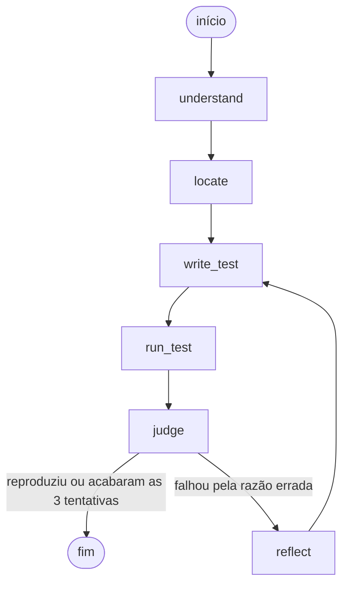

# repro-agent

Agente de IA que transforma um relato de bug em um teste pytest que reproduz o bug, e uma suíte de
avaliação que mede, com números, o quanto ele acerta.

## O problema

Relatos de bug chegam em linguagem natural e muitas vezes são vagos. O primeiro passo para
corrigir um bug é reproduzi-lo com um teste que falha, e esse passo costuma ser manual, lento e
depender de quem conhece o código.

O repro-agent recebe o texto do relato e a pasta de um projeto Python com pytest, e devolve:

- um arquivo `tests/test_repro_<id>.py` que falha no código com bug, pela razão certa;
- um relatório JSON com status, tentativas, tokens, custo estimado e tempo.

Para saber se o agente é confiável, e não só se "parece funcionar", o projeto traz uma suíte de
avaliação com bugs conhecidos. Um teste só conta como reprodução válida se for **fail-to-pass**:
falha na versão com bug e passa na versão correta.

A especificação completa está em [SPEC.md](SPEC.md).

## Como funciona

O agente é um grafo em [LangGraph](https://github.com/langchain-ai/langgraph):



| Nó | Usa LLM | O que faz |
| --- | --- | --- |
| `understand` | sim | Lê o relato e produz uma análise estruturada (Pydantic): comportamento esperado e observado, gatilho, módulos suspeitos e, quando o próprio bug é uma exceção, o nome dela. |
| `locate` | sim | Loop ReAct de até 8 passos com ferramentas somente leitura (listar, ler e buscar), presas à pasta do projeto. |
| `write_test` | sim | Escreve o teste, a partir do relato, da análise, do resumo do `locate`, do código lido e, se houver, da tentativa anterior com a reflexão. |
| `run_test` | não | Roda só esse teste com pytest em subprocesso, numa cópia temporária do projeto, com timeout de 60 s. |
| `judge` | não | Decide de forma determinística: reproduziu (falhou com `AssertionError`, ou com a exceção que o relato descreve como bug) ou falhou pela razão errada (passou, erro de import, de sintaxe, de coleta, fixture inexistente, timeout, exceção inesperada). |
| `reflect` | sim | Explica o que deu errado, para a próxima tentativa do `write_test`. |

O estado do grafo guarda o relato, a análise, os arquivos lidos, o código e a saída do pytest de
cada tentativa, as reflexões e a contagem de tokens por nó.

### Estrutura do repositório

```
src/repro_agent/
    llm.py            interface ChatModel, provedores Gemini e DeepSeek, configuração
    fake_llm.py       modelo falso roteirizado, usado nos testes
    tools.py          ferramentas de leitura do locate
    judge.py          judge determinístico
    state.py          estado do grafo e configuração do agente
    nodes/            um arquivo por nó
    prompts/          prompts de cada nó, em arquivos .md
    graph.py          montagem do grafo e função reproduce()
    report.py         relatório JSON de uma execução
    evaluation.py     runner da suíte de avaliação
    cli.py            comandos repro run e repro eval
tests/                testes do próprio projeto (sem chave de API)
evals/
    fixtures/pedido/  projeto alvo de exemplo, na versão correta
    cases/<id>/       issue.md (relato) e bug.patch (introduz o bug)
    results/          resultados das avaliações
    run.py            atalho para repro eval
```

## Como rodar

Requer [uv](https://docs.astral.sh/uv/), `git` e `make`. O uv instala o Python 3.12 se precisar.

```bash
uv sync
```

### Configurar o provedor

Copie o exemplo e preencha a chave do provedor escolhido:

```bash
cp .env.example .env
```

| Variável | Obrigatória | Exemplo |
| --- | --- | --- |
| `REPRO_PROVIDER` | sim | `gemini` ou `deepseek` |
| `REPRO_MODEL` | sim | `gemini-2.5-flash`, `deepseek-chat` |
| `GEMINI_API_KEY` ou `DEEPSEEK_API_KEY` | sim, a do provedor escolhido | |
| `REPRO_LLM_TIMEOUT` | não | `60` (segundos por chamada) |
| `REPRO_PRICE_INPUT_PER_MTOK` e `REPRO_PRICE_OUTPUT_PER_MTOK` | não | preço em dólares por milhão de tokens, para estimar o custo |

A chave do Gemini é criada no [Google AI Studio](https://aistudio.google.com/apikey). A do
DeepSeek, na [plataforma da DeepSeek](https://platform.deepseek.com/api_keys). O `.env` está no
`.gitignore` e nunca deve ir para o repositório.

### Reproduzir um bug

```bash
uv run repro run --repo caminho/do/projeto --issue relato.md
```

O relatório JSON sai na saída padrão (e em `--report arquivo.json`, se passar a opção). Se o bug
for reproduzido, o teste é gravado em `tests/test_repro_<id>.py` dentro do projeto. Opções úteis:
`--model`, `--provider`, `--test-id`, `--max-attempts`, `--no-write` e `--python` (o Python que
roda o teste, quando o projeto tem dependências próprias).

Códigos de saída: 0 reproduziu, 1 não reproduziu, 2 configuração inválida, 3 erro na execução.

### Rodar a avaliação

```bash
uv run repro eval
```

ou, para escolher modelo e casos:

```bash
uv run python evals/run.py --model gemini-2.5-flash --cases centavo_a_mais,cupom_acima_de_100
```

A tabela sai na tela e fica salva em `evals/results/<data>_<modelo>.md`, junto com o JSON
completo. A avaliação chama o LLM de verdade e **não** roda no CI.

### Verificar o projeto

```bash
make verify
```

Roda o ruff (lint e formatação), o mypy e a suíte pytest. Os testes usam o modelo falso e não
precisam de chave nem de rede. O CI roda o mesmo comando a cada push.

## Suíte de avaliação

O projeto alvo `evals/fixtures/pedido` calcula pedidos de delivery: subtotal, cupom percentual e
de valor fixo, taxa de entrega com frete grátis a partir de R$ 100,00, arredondamento em centavos
e validação de quantidade. Cada caso introduz um bug com um patch:

| Caso | Bug | Relato |
| --- | --- | --- |
| `frete_gratis_no_valor_minimo` | `>=` virou `>` no frete grátis | claro |
| `desconto_maior_que_o_esperado` | cupom aplicado sobre subtotal mais taxa de entrega | vago |
| `centavo_a_mais` | desconto percentual calculado com `float` | vago |
| `cupom_acima_de_100` | cupom percentual acima de 100% aceito | claro |
| `carrinho_vazio_cobra_taxa` | carrinho vazio cobra a taxa de entrega | claro |

Os testes do próprio `pedido` continuam passando com cada bug, como acontece com bugs reais. O
teste `tests/test_eval_cases.py` garante que cada patch aplica e que cada caso tem solução: um
teste de referência, que o agente nunca vê, é fail-to-pass em todos.

## Resultados

Ainda sem resultados com modelo real. Cada rodada de `repro eval` gera uma tabela em
`evals/results/`, e o resumo entra aqui.

| Modelo | Data | Reprodução válida | Média de tentativas | Tokens (entrada / saída) | Custo (US$) |
| --- | --- | --- | --- | --- | --- |
| | | | | | |

## Segurança e limitações

> **Atenção:** o teste gerado é código escrito por um LLM e executado na sua máquina, com as suas
> permissões. O agente roda o teste numa cópia temporária do projeto e nunca altera outros
> arquivos, mas isso não é um sandbox: o código do teste pode acessar a rede e o sistema de
> arquivos. Use em projetos e relatos em que você confia. Rodar o teste dentro de um container
> Docker é o próximo passo planejado.

Outras limitações conhecidas:

- Só projetos Python com pytest.
- O teste roda com o Python do próprio agente, a não ser que se passe `--python`. O projeto
  alvo precisa ser importável por esse Python.
- O judge lê o texto da saída do pytest no formato de traceback padrão. Plugins que mudem esse
  formato podem confundir a classificação.
- As ferramentas do `locate` leem só texto, com limites de tamanho, e o `locate` tem 8 passos.
- A temperatura dos modelos não é configurada, então o resultado varia entre rodadas. Com 5 casos,
  cada caso vale 20 pontos percentuais na taxa de reprodução.
- Se o provedor falhar no meio de uma execução, os tokens gastos até ali não entram no relatório.
- As docstrings do projeto `pedido` descrevem o comportamento correto, o que pode facilitar os
  casos em relação a um projeto real.

## Decisões de projeto

Decisões técnicas que a [SPEC.md](SPEC.md) não define. Cada uma traz a decisão, a alternativa
considerada e o motivo.

### Estrutura e verificação

- **Dependências só quando usadas.** Hoje o projeto depende apenas de ruff, mypy e pytest.
  Alternativa: instalar desde já LangGraph, Pydantic e Typer. Motivo: dependência sem código que
  a use só aumenta o lockfile e o tempo de CI.
- **`make verify` inclui `ruff format --check`.** Alternativa: só `ruff check`. Motivo: formatação
  divergente vira ruído nos diffs de revisão.
- **mypy no modo padrão, em `src` e `tests`.** O projeto alvo em `evals/fixtures` fica de fora do
  mypy, mas passa pelo ruff. Alternativa: `--strict` ou checar tudo. Motivo: a SPEC pede modo
  básico, e o projeto alvo é um projeto separado, que só existe para ser analisado.
- **pytest com `testpaths = ["tests"]`.** Alternativa: deixar o pytest descobrir testes no
  repositório inteiro. Motivo: os testes do `pedido` usam outra raiz de importação. Eles rodam
  dentro de `tests/test_eval_cases.py`, numa cópia temporária.
- **CI em todo push e pull request, com `uv sync --locked`.** Alternativa: só na branch principal.
  Motivo: cada branch de trabalho precisa de verificação antes de virar pull request, e `--locked`
  falha se o `uv.lock` estiver desatualizado.

### Ferramentas de leitura (`tools.py`)

- **Três verificações por caminho:** absoluto é recusado, `..` é recusado e o caminho real
  (depois de seguir links simbólicos) precisa estar dentro da raiz. A terceira é a que garante a
  segurança. As duas primeiras dão ao modelo uma mensagem de erro clara. Alternativa: só a
  terceira. Motivo: mensagem específica ajuda o modelo a corrigir a próxima chamada.
- **`..` é recusado mesmo quando o caminho continuaria dentro do projeto** (`pkg/../order.py`).
  Alternativa: aceitar e deixar a terceira verificação decidir. Motivo: regra mais simples de
  explicar e o modelo nunca precisa de `..`.
- **Links simbólicos que apontam para dentro do projeto são aceitos.** Os que apontam para fora
  geram erro na leitura e são pulados na listagem e na busca. Alternativa: recusar qualquer link.
  Motivo: links internos são comuns e inofensivos.
- **Busca por substring, diferenciando maiúsculas de minúsculas, com limites** (200 arquivos na
  listagem, 20.000 caracteres na leitura, 50 resultados na busca) e ignorando `.git`, `.venv`,
  `__pycache__` e caches. Alternativa: expressões regulares e sem limites. Motivo: substring é
  previsível, e os limites protegem o contexto do modelo.
- **Erros viram exceções** (`UnsafePathError`, `FileNotFoundError`). Alternativa: devolver texto de
  erro. Motivo: as funções ficam testáveis de forma direta. O adaptador para o LangGraph deve
  converter a exceção em mensagem para o modelo.

### Judge (`judge.py`)

- **Lê o texto da saída do pytest.** Alternativa: gerar e ler um relatório JUnit XML. Motivo:
  menos peças e mais fácil de entender. Exige que o pytest rode no formato de traceback padrão
  (sem `--tb=no` ou `--tb=line`), porque o tipo da exceção vem da última linha de cada falha, por
  exemplo `calc.py:2: ZeroDivisionError`.
- **`Failed` conta como reprodução**, além de `AssertionError`. É a exceção do `pytest.raises`
  quando nada é levantado ("DID NOT RAISE"). Alternativa: aceitar só `AssertionError`. Motivo: é
  o jeito natural de provar que falta uma validação.
- **A exceção descrita no relato vem como parâmetro** (`expected_exception`). Alternativa: o judge
  interpretar o relato. Motivo: o judge continua determinístico e só compara nomes. Quem extrai a
  exceção do relato é o nó understand.
- **Todas as falhas precisam ser do tipo certo.** Se um teste falha por `AssertionError` e outro
  por `TypeError`, o resultado é `UNEXPECTED_EXCEPTION`. Qualquer erro de coleta ou de setup também
  conta como razão errada. Alternativa: aceitar se pelo menos uma falha for boa. Motivo: um arquivo
  com erro não prova nada de forma confiável.
- **Categorias além das listadas na SPEC:** `SETUP_ERROR` (fixture que existe mas falha),
  `NO_TESTS` (código de saída 5) e `PYTEST_ERROR` (códigos 3 e 4, ou saída não reconhecida).
  Alternativa: agrupar tudo em erro genérico. Motivo: o nó reflect recebe uma explicação mais útil.
- **`dataclass` e `StrEnum` em vez de Pydantic.** Motivo: não há validação de dados externos
  aqui. Pydantic fica para as saídas estruturadas do LLM.
- **Os testes do judge rodam o pytest de verdade** em subprocesso, sobre arquivos criados numa
  pasta temporária. Alternativa: textos de saída gravados no repositório. Motivo: se uma versão
  nova do pytest mudar o formato, os testes quebram e avisam.

### Projeto alvo e casos de avaliação

- **Código do `pedido` em inglês, com o nome do pacote em português.** A SPEC pede código em
  inglês e fixa o nome `pedido`. Os relatos ficam em português, como um usuário brasileiro
  escreveria.
- **Regras de negócio do `pedido`:** taxa de entrega de R$ 7,90; frete grátis a partir de
  R$ 100,00, inclusive, calculado sobre o subtotal antes do desconto; cupom só sobre o subtotal,
  nunca sobre a entrega; cupom fixo limitado ao subtotal; cupom de 100% permitido; quantidade
  entre 1 e 99; arredondamento meio para cima (`ROUND_HALF_UP`); valores sempre em `Decimal`.
- **As docstrings do `pedido` descrevem o comportamento correto** e continuam iguais na versão
  com bug. Alternativa: docstrings neutras. Motivo: comentário que diverge do código é realista.
  Se os casos ficarem fáceis demais, enxugar as docstrings é o primeiro ajuste.
- **Ids dos casos em snake_case.** Motivo: o id vira parte de `tests/test_repro_<id>.py`, que
  precisa ser um nome de módulo Python válido.
- **Patches no formato `git diff`**, com caminhos relativos à raiz do `pedido`, aplicados com
  `git apply` dentro da cópia. Alternativa: o comando `patch`. Motivo: o git já é dependência do
  projeto e falha de forma clara quando o patch não aplica.
- **Os testes de referência de cada caso ficam em `tests/test_eval_cases.py`**, não em
  `evals/cases`. Motivo: o agente nunca deve ter acesso a eles.
- **Cada bug escapa dos testes do próprio `pedido`.** Alternativa: deixar os testes do projeto
  pegarem alguns bugs. Motivo: bug que os testes pegam não precisaria de relato.

### Camada de LLM (`llm.py`)

- **HTTP direto com httpx, sem SDK dos provedores.** Alternativa: os SDKs oficiais ou os modelos
  de chat do LangChain. Motivo: as duas chamadas cabem em poucas linhas, ficam visíveis no código
  e são testadas sem rede com `httpx.MockTransport`.
- **Interface mínima: `complete(node, system, messages, json_mode)`**, que devolve o texto e os
  tokens. Alternativa: chamada de ferramentas nativa de cada provedor. Motivo: Gemini e DeepSeek
  têm formatos diferentes para ferramentas, enquanto modo JSON e texto puro funcionam igual nos
  dois. O loop ReAct do locate usa JSON.
- **O parâmetro `node` identifica a chamada.** Os provedores reais só o usam no log. O modelo falso
  usa para escolher a próxima resposta do roteiro de cada nó, o que deixa os testes legíveis.
- **Saída estruturada com Pydantic e uma segunda chance.** Se o JSON não valida, o erro volta para
  o modelo uma vez. Alternativa: falhar de primeira. Motivo: erro de formato é comum e barato de
  corrigir.
- **Novas tentativas só para 429, erros 5xx e falhas de rede**, até 3 tentativas no total,
  respeitando o cabeçalho `Retry-After` (limitado a 60 s). Alternativa: sem novas tentativas.
  Motivo: o plano gratuito do Gemini devolve 429 com frequência.
- **Tokens de raciocínio do Gemini contam como saída** (`thoughtsTokenCount`), porque são cobrados
  como saída.
- **Preços por variável de ambiente** (`REPRO_PRICE_INPUT_PER_MTOK` e
  `REPRO_PRICE_OUTPUT_PER_MTOK`, em dólares por milhão de tokens). Sem elas, o custo sai como
  `null`. Alternativa: tabela de preços no código. Motivo: preços mudam e o modelo não é fixo.
- **O modelo falso fica no pacote** (`fake_llm.py`), não em `tests/`. Motivo: é a referência mais
  simples da interface `ChatModel` e pode ser usado em demonstrações sem chave.

### Nós do agente (`nodes/` e `prompts/`)

- **Prompts em inglês, em arquivos `.md` separados** (`<nó>.system.md` com as instruções fixas e
  `<nó>.user.md` com o modelo da mensagem). Os relatos continuam em português e são passados como
  vieram. Alternativa: prompts em português ou embutidos no código. Motivo: o resto do código é em
  inglês, e arquivo separado deixa o prompt fácil de ler e de comparar no diff.
- **Modelos de texto com `string.Template`** (`$issue`). Alternativa: `str.format` ou Jinja.
  Motivo: os prompts têm chaves de JSON, que no `str.format` precisariam ser escapadas, e Jinja
  seria mais uma dependência.
- **O loop ReAct do locate fica dentro de um único nó**, e não como arestas do grafo. Motivo: o
  grafo fica com o desenho da seção 4 da SPEC, e o loop é um `for` fácil de testar.
- **Cada passo do locate é um objeto JSON** com `tool`, `path`, `query` e `summary`. Erros das
  ferramentas viram uma observação que começa com `Error:`, para o modelo corrigir o próximo passo.
- **O write_test recebe o conteúdo dos arquivos lidos no locate** (até 60.000 caracteres), além do
  resumo. Alternativa: só o resumo. Motivo: o maior risco é o teste importar nomes que não existem,
  e o código real evita isso.
- **O write_test pede um bloco ```python**, não JSON. Motivo: código dentro de JSON precisa de
  escapes e erra mais. Se não houver bloco, a resposta inteira é tratada como código.
- **Só a última tentativa e a última reflexão vão para a próxima tentativa.** Alternativa: o
  histórico inteiro. Motivo: prompt menor, e a última reflexão já resume o que mudar.
- **O código do teste fica no estado durante o grafo.** O run_test cria uma cópia temporária nova a
  cada tentativa, grava o teste lá e roda `python -m pytest -p no:cacheprovider --tb=auto
  tests/test_repro_<id>.py`. O `--tb=auto` garante o formato que o judge lê, mesmo que o projeto
  configure outro, e o `PYTEST_ADDOPTS` do ambiente é ignorado.
- **A cópia não inclui `.git`, `.venv` e caches**, e copia links simbólicos como links.
- **O teste roda com o mesmo Python do agente** (`sys.executable`), configurável em
  `AgentConfig.python_executable`. Motivo: o projeto de exemplo não tem dependências. Um projeto
  real precisa apontar para o Python do próprio ambiente.
- **A tentativa guarda só os últimos 8.000 caracteres da saída do pytest.** O judge recebe a saída
  inteira, e o reflect recebe o final, onde está o resumo das falhas.
- **O nome do arquivo de teste vem de `repro_test_path`**, e não `test_file_path`. Motivo: o pytest
  coleta como teste qualquer função importada que comece com `test_`.

### Grafo (`graph.py`)

- **Estado como `TypedDict`, e cada nó devolve só as chaves que muda.** Listas (tentativas,
  reflexões) são devolvidas inteiras, já com o item novo. Alternativa: reducers do LangGraph,
  que juntam listas automaticamente. Motivo: o que cada nó escreve fica explícito no próprio nó.
- **Dependências entram por lambdas** (`lambda state: understand(state, llm)`). Alternativa:
  passar o modelo pelo `config` do LangGraph. Motivo: os nós continuam funções comuns, testáveis
  sem o grafo.
- **"Máximo de 3 tentativas no total" conta as execuções de write_test.** Depois da terceira não
  há reflexão, porque ela não seria usada.
- **O grafo nunca grava no projeto alvo.** Quem decide gravar o teste final é a CLI.

### CLI e relatório (`cli.py` e `report.py`)

- **O relatório JSON vai para a saída padrão**, e os logs vão para a saída de erro. `--report`
  também grava o JSON num arquivo. Alternativa: só arquivo. Motivo: dá para encadear com outras
  ferramentas (`repro run ... | jq .status`).
- **Códigos de saída:** 0 reproduziu, 1 não reproduziu, 2 configuração inválida, 3 erro durante a
  execução (por exemplo, o provedor fora do ar). No caso 3, o relatório sai com `status: "error"` e
  sem a contagem de tokens gastos até a falha.
- **O teste só é gravado no projeto quando reproduz o bug**, em `tests/test_repro_<id>.py`.
  `--no-write` desliga a gravação. Alternativa: gravar sempre. Motivo: um teste que não reproduz o
  bug não deveria aparecer no projeto. O código dele continua no relatório.
- **O `<id>` padrão vem do nome do arquivo do relato**, sem acentos e em snake_case
  (`frete gratis.md` vira `frete_gratis`). Quando o arquivo se chama só `issue.md`, como nos casos
  de avaliação, o id vem da pasta (`evals/cases/centavo_a_mais/issue.md` vira `centavo_a_mais`).
  `--test-id` escolhe outro.
- **O custo estimado é arredondado em seis casas decimais** (um milionésimo de dólar).
- **O `.env` é lido da pasta atual.** Variáveis já definidas no ambiente têm prioridade sobre o
  `.env`, e `--provider` e `--model` têm prioridade sobre os dois.

### Avaliação (`evaluation.py` e `evals/run.py`)

- **A lógica fica em `src/repro_agent/evaluation.py`**, e `evals/run.py` só chama `repro eval`.
  Motivo: a CLI e o script compartilham o mesmo código, e o pacote instalado tem acesso a ele.
- **O fail-to-pass roda o teste de novo nas duas versões**, cada uma numa cópia nova, mesmo que o
  agente já tenha rodado na versão com bug. Motivo: a checagem não depende de nada que o agente
  disse.
- **Status de cada caso:** `valid` (falha na versão com bug pela razão certa e passa na correta),
  `not_reproduced` (o agente esgotou as tentativas), `not_fail_to_pass` (falhou na versão com bug,
  mas também falha na correta) e `error` (falha do provedor). Um caso com erro não interrompe os
  outros.
- **A média de tentativas considera só os casos em que o agente tentou ao menos uma vez.**
- **O custo total sai como "não estimado" se algum caso não tiver custo**, para não mostrar um
  total parcial como se fosse completo.
- **Os arquivos de resultado levam data e hora** (`2026-11-17_043000_<modelo>.json` e `.md`).
  Alternativa: só a data. Motivo: duas rodadas no mesmo dia não se sobrescrevem.
- **`evals/results/` é versionado**, porque é a evidência da tabela do README.
